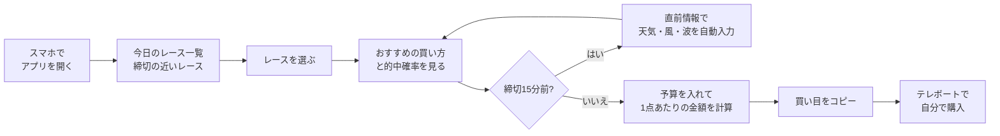
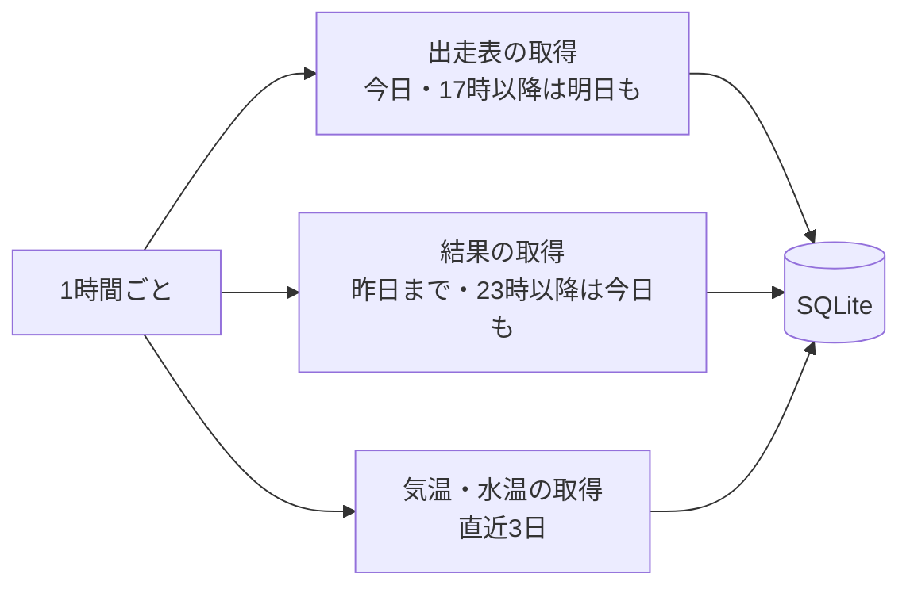
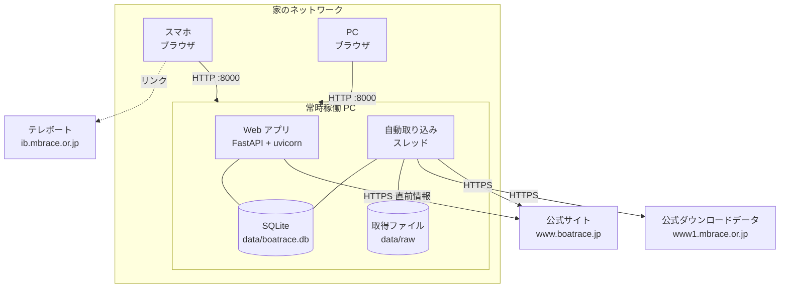

# 競艇予測システム 基本設計書

| 項目 | 内容 |
|---|---|
| システム名 | 競艇予測（BOATRACE PREDICTOR） |
| リポジトリ / ブランチ | Hikachius_App / `app/boatrace` |
| 文書版数 | 1.0 |
| 作成日 | 2026-11-13 |
| 関連文書 | [02_外部設計書](02_外部設計書.md) / [03_内部設計書](03_内部設計書.md) |

---

## 1. システム概要

### 1.1 目的
ボートレース（競艇）の公式データを自動で集め、出走選手が **どのような天候・気温・風・波のときに上位に入っているか** を分析する。その結果から各艇の着順確率と買い目を提示し、初心者でも迷わずに舟券の買い方を決められるようにする。

### 1.2 背景
- 予想を確実に当てることはできないが、過去データにもとづいた確率を出せば、判断の根拠にはなる。
- 公式サイトの出走表や結果は情報量が多く、初心者には読み解きにくい。
- 気象条件ごとの選手の得意・苦手は、公式サイトでは集計されていない。

### 1.3 利用者

| 利用者 | 説明 | 主な利用端末 |
|---|---|---|
| 一般利用者 | 舟券を買う本人。競艇の初心者も含む | 家の Wi-Fi につないだスマホ、PC |
| 運用者 | システムを起動・保守する本人（利用者と同じ人） | 常時稼働 PC |

### 1.4 システム化の範囲

| 区分 | 内容 |
|---|---|
| 対象 | 公式データの取得・蓄積、選手の条件別成績の集計、着順確率の推定、買い目の提示、回収率の検証、Web 画面での閲覧 |
| 対象外 | 舟券の自動購入（購入は利用者がテレボートで行う）、オッズの取得、インターネット公開、複数ユーザーの管理 |

---

## 2. 利用シナリオ（業務フロー）

自動で行う処理（利用者の操作は不要）:

---

## 3. 機能一覧

| 機能ID | 機能名 | 概要 | 区分 |
|---|---|---|---|
| F-01 | 競走成績の取り込み | 公式の競走成績ファイル（K ファイル）から、結果・天候・風・波・払戻金を取り込む | バッチ |
| F-02 | 出走表の取り込み | 公式の番組表ファイル（B ファイル）から、出走選手・勝率・モーター・締切時刻を取り込む | バッチ / 画面 |
| F-03 | 気温・水温の取り込み | 公式サイトのレース結果ページから気温・水温を取り込む | バッチ |
| F-04 | 自動取り込み | F-01〜F-03 を 1 時間ごとに実行し、足りない日を埋める | 常駐 |
| F-05 | 直前情報の取得 | 公式サイトの直前情報から、今の天候・風・波・気温を取得して予想条件に入れる | 画面 |
| F-06 | 条件別成績の集計 | 選手ごとに、天候・風・波・気温・枠・場の区分別に成績を集計する | 内部 |
| F-07 | 着順確率の推定 | 枠・選手実績・条件別成績・勝率・モーターから強さを出し、1〜3 着の確率を推定する | 内部 |
| F-08 | 券種別の的中確率 | 7 券種（単勝・複勝・2 連単・2 連複・拡連複・3 連単・3 連複）の組み合わせごとの確率を出す | 内部 |
| F-09 | おすすめの買い方 | レースの堅さを判定し、券種・買い目・点数を 1 つ提案する | 画面 |
| F-10 | 買い目の手動選択 | 利用者が券種・点数・予算を選び、確率の高い買い目を表示する | 画面 |
| F-11 | 予算の配分 | 予算を点数で割り、100 円単位の 1 点あたりの金額を出す | 画面 |
| F-12 | 買い目のコピー | 購入用の買い目テキストをクリップボードにコピーする | 画面 |
| F-13 | テレボート連携 | 公式のインターネット投票サイトを開く（リンクのみ） | 画面 |
| F-14 | 選手検索 | 名前の一部または登録番号で選手を探す | 画面 |
| F-15 | 選手詳細 | 選手の条件別・枠別・場別の成績を表示する | 画面 |
| F-16 | 回収率の検証 | 過去のレースを予想どおりに買った場合の的中率・回収率を計算する | バッチ |
| F-17 | 検証結果の表示 | F-16 の結果を、買い方ごとに比べて表示する | 画面 |
| F-18 | 初心者ガイド | 使い方・ボートの色・券種・用語を説明する | 画面 |
| F-19 | スマホ接続案内 | 家の Wi-Fi で開くための URL と QR コードを表示する | 画面 |
| F-20 | 取り込み状況の表示 | 最終更新時刻・取り込み件数・更新履歴を表示し、手動で更新できる | 画面 |

---

## 4. 非機能要件

### 4.1 性能

| 項目 | 目標 | 実測（2026-11-13） |
|---|---|---|
| レース予想画面の表示 | 2 秒以内 | 1 秒未満（過去データ約 2.1 万レース） |
| 競走成績の取り込み | 1 日分 30 秒以内 | 数秒〜十数秒（通信状況による） |
| 気温の取り込み | 1 件 2 秒以内 | 約 1.2 秒（うち 1 秒は意図的な待ち） |
| 回収率の検証 | 2,000 レースで 15 分以内 | 2,440 レースで数分 |

### 4.2 可用性
- 常時稼働 PC で動かす。PC が止まっていた期間のデータは、次の起動時に自動取り込みが追いついて埋める。
- 1 件の取得に失敗しても処理は続け、次の回にやり直す。

### 4.3 セキュリティ
- 家の LAN の中だけで使う。インターネットには公開しない。
- Windows ファイアウォールは **プライベートネットワークのみ** 許可する（運用者が設定する）。
- ログイン機能は持たない（LAN 内の 1 人での利用を前提とする）。
- 舟券の購入情報、テレボートの ID やパスワードは一切扱わない。
- 公式サイトの証明書の検証は無効にしない。OS の証明書ストアで検証する。

### 4.4 外部サイトへの配慮
- 公式サイトへのアクセスは、1 リクエストごとに 1 秒待つ。
- 取得したファイルはローカルにキャッシュし、同じものを何度も取りに行かない。

### 4.5 保守性
- 予想ロジックの係数は 1 か所（`boatrace/predict/model.py`）にまとめる。
- 予想ロジックの変更は、回収率の検証（F-16）で効果を確かめてから取り入れる。

### 4.6 利用上の注意の表示
- すべての画面に「予想は保証ではない」「舟券は 20 歳から」「無理のない金額で」を表示する。

---

## 5. システム構成

### 5.1 全体構成

### 5.2 ハードウェア

| 機器 | 役割 | 条件 |
|---|---|---|
| 常時稼働 PC | Web サーバー、DB、自動取り込み | Windows 10 / 11、インターネットに接続できること |
| スマホ / PC | 画面の閲覧 | 常時稼働 PC と同じ Wi-Fi に接続 |

### 5.3 ソフトウェア

| 区分 | 採用 | 選定理由 |
|---|---|---|
| 言語 | Python 3.11 以上（開発環境は 3.15） | データ分析・機械学習のライブラリが豊富 |
| Web フレームワーク | FastAPI | 軽量で、画面と API の両方を作れる |
| Web サーバー | uvicorn | FastAPI 標準 |
| テンプレート | Jinja2 | サーバー側で HTML を作れば、スマホ側の負荷が小さい |
| DB | SQLite | サーバー不要。1 人で使う規模に十分 |
| HTTP | requests + truststore | 公式サーバーの証明書を OS の証明書ストアで検証するため |
| QR コード | segno | 純 Python で SVG を出せる |
| LZH 展開 | Windows 標準の tar（bsdtar） | 追加のインストールが不要 |

---

## 6. データ概要

| データ | 内容 | 取得元 | 更新タイミング |
|---|---|---|---|
| レース | 日付・場・レース番号・天候・風・波・気温・水温 | K ファイル + 公式サイト | 毎日（翌日に確定） |
| 結果 | 艇ごとの着順・展示タイム・進入・ST | K ファイル | 毎日 |
| 払戻金 | 券種・組番・払戻金・人気 | K ファイル | 毎日 |
| 出走表 | レースごとの締切時刻・選手・級別・勝率・モーター・ボート | B ファイル | 前日〜当日 |
| 取り込み履歴 | 自動取り込みの開始・終了・結果 | システム | 1 時間ごと |
| 検証結果 | 買い方ごとの回収率など | システム（JSON） | 手動実行時 |

テーブルの詳細は [03_内部設計書](03_内部設計書.md) の「DB 設計」を参照。

---

## 7. 外部インタフェース概要

| IF-ID | 相手 | 方向 | 方式 | 内容 |
|---|---|---|---|---|
| IF-01 | 公式ダウンロードデータ（競走成績） | 受信 | HTTPS / LZH 圧縮テキスト（Shift_JIS） | 日別の全場の結果 |
| IF-02 | 公式ダウンロードデータ（番組表） | 受信 | HTTPS / LZH 圧縮テキスト（Shift_JIS） | 日別の全場の出走表 |
| IF-03 | 公式サイト（レース結果ページ） | 受信 | HTTPS / HTML | 気温・水温 |
| IF-04 | 公式サイト（直前情報ページ） | 受信 | HTTPS / HTML | 現在の天候・風・波・気温 |
| IF-05 | テレボート | なし（リンク） | ブラウザで開く | 利用者が自分で購入する |

詳細は [02_外部設計書](02_外部設計書.md) の「外部システム IF」を参照。

---

## 8. 運用概要

| 項目 | 内容 |
|---|---|
| 起動 | `start_server.bat` をダブルクリック。PC 起動時の自動起動は、スタートアップフォルダにショートカットを置く |
| 停止 | サーバーの画面（黒いウィンドウ）を閉じる |
| データ更新 | 自動（1 時間ごと）。「設定」画面の「今すぐ更新」でも実行できる |
| 監視 | 画面右上の「更新 HH:MM」の印（緑 = 成功、赤 = 失敗）と「設定」画面の更新履歴 |
| バックアップ | `data/boatrace.db` をコピーする。`data/raw` があれば DB は作り直せる |
| 検証 | 予想ロジックを変えたら `python -m boatrace.backtest` を実行する |

---

## 9. 前提・制約

- 公式のダウンロードデータと公式サイトの形式が変わると、取り込みが止まる可能性がある。
- 公式は外部アプリから舟券を買う手段を提供していないため、購入は利用者がテレボートで行う。
- 気温は K ファイルに入っていないので、1 レースずつ公式サイトから取る（時間がかかる）。
- 予想はオッズを使っていないため、「当たりやすさ」は出せても「儲かるか（期待値）」は判断できない。

---

## 10. リスクと課題

| No | 内容 | 影響 | 対応 |
|---|---|---|---|
| R-01 | 回収率がどの買い方でも 100% に届かない（検証: 2026/10/20〜11/04、2,440 レース。最高は複勝 本命 1 点の 95.5%） | 続けると損をする | オッズを取り込み、期待値が 1 を超える買い目だけを選ぶ（課題 T-01） |
| R-02 | 予想 1 着率が 70% を超える艇で、確率が高く出すぎる（予想 83.7% → 実際 76.9%） | おすすめが強気になりすぎる | 機械学習で係数を調整する（課題 T-02） |
| R-03 | 公式のデータ形式の変更 | 取り込みの停止 | 「設定」画面の赤い印で気づける。パーサーを直す |
| R-04 | 新しい Python 用のライブラリが配布されていないことがある | インストールの失敗 | `uvicorn[standard]` を使わないなど、依存を最小にする |

## 11. 今後の拡張

| 課題ID | 内容 |
|---|---|
| T-01 | オッズの取り込みと、期待値（確率 × オッズ）による買い目の選択 |
| T-02 | LightGBM などで係数を学習して自動で調整する |
| T-03 | 場ごとの風向き（追い風・向かい風）を考慮する |
| T-04 | 展示タイム・スタート展示を予想に入れる |
| T-05 | 検証結果を定期的に自動で更新する |
