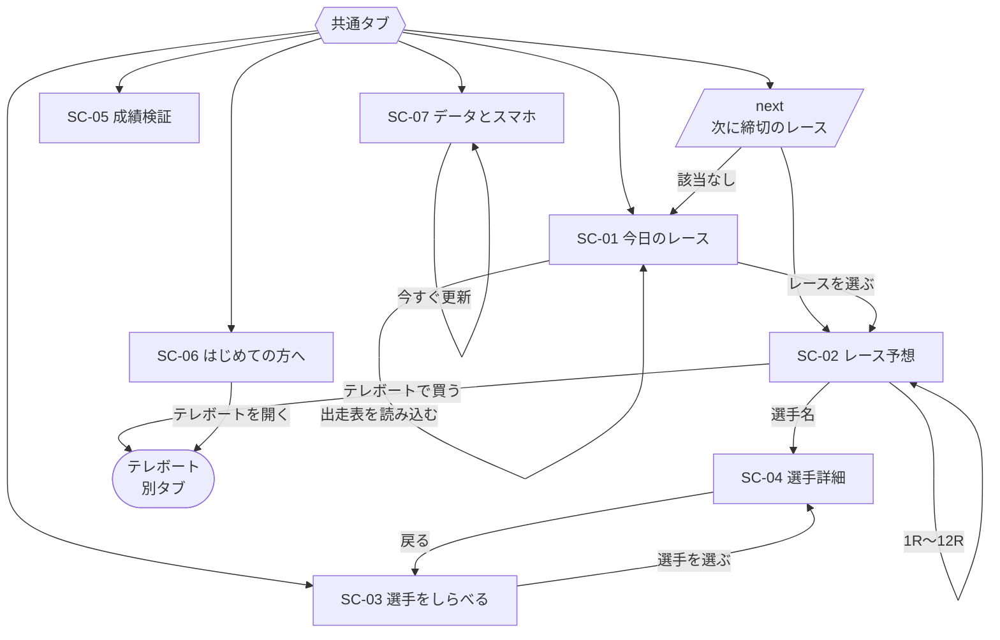

# 競艇予測システム 外部設計書

| 項目 | 内容 |
|---|---|
| システム名 | 競艇予測（BOATRACE PREDICTOR） |
| 文書版数 | 1.0 |
| 作成日 | 2026-11-13 |
| 関連文書 | [01_基本設計書](01_基本設計書.md) / [03_内部設計書](03_内部設計書.md) |

---

## 1. 画面一覧

| 画面ID | 画面名 | URL | 下部タブ | 対応機能 |
|---|---|---|---|---|
| SC-01 | 今日のレース | `/` | レース | F-02, F-04 |
| SC-02 | レース予想 | `/race/{race_id}` | 予想 | F-05, F-07〜F-13 |
| SC-03 | 選手をしらべる | `/racers` | 選手 | F-14 |
| SC-04 | 選手詳細 | `/racer/{racer_id}` | 選手 | F-15 |
| SC-05 | 成績検証 | `/backtest` | 成績 | F-17 |
| SC-06 | はじめての方へ | `/guide` | はじめて | F-18 |
| SC-07 | データとスマホ | `/settings` | 設定 | F-19, F-20 |

## 2. 画面遷移



---

## 3. 共通レイアウト

### 3.1 構成

| 領域 | 内容 |
|---|---|
| ヘッダー（上部に固定） | ロゴ、システム名「競艇予測 / BOATRACE PREDICTOR」、最終更新の印（「更新 HH:MM」。緑の点 = 成功、赤の点 = 失敗。押すと SC-07 へ） |
| タブ | 6 つ: レース / 予想 / 選手 / 成績 / はじめて / 設定。選択中のタブは強調表示 |
| 本文 | 各画面の内容（最大幅 1080px） |
| フッター | 「予想は過去のデータからの推定で、当たることを保証するものではありません。」「舟券は 20 歳になってから。無理のない金額で楽しもう。」 |
| トースト | 画面下に一時的に出るお知らせ（例:「買い目をコピーしたよ」）。2.2 秒で消える |

### 3.2 レスポンシブ

| 画面幅 | タブの位置 | タブの見た目 |
|---|---|---|
| 721px 以上（PC） | ヘッダーの下に固定 | アイコン + 文字の横並び。選択中は水色の塗り |
| 720px 以下（スマホ） | 画面下に固定（タブバー） | アイコンの下に文字。選択中は水色に光る |

- スマホでは、ホーム画面に追加するとアプリのように全画面で開く（Web App Manifest）。
- iPhone の画面下の安全領域（ホームバー）を避けて表示する。

### 3.3 デザインの決まり

| 項目 | 内容 |
|---|---|
| テーマ | ナイトレース（暗い水面の背景） |
| 基本色 | 背景 `#070b16` / 文字 `#eef2ff` / 補足文字 `#8d98b8` |
| 強調色 | ネオンブルー `#3ad7ff`（主ボタン・確率） / レースの黄色 `#ffd400`（締切時刻・金額・選択中のサブタブ・テレボートボタン） |
| 状態色 | 得意・プラス `#2ee6a0` / 苦手・マイナス `#ff6b7a` / 注意 `#ffb547` |
| 文字 | 本文 Noto Sans JP、数字 Oswald |
| ボートの色 | 1 白 / 2 黒 / 3 赤 / 4 青 / 5 黄 / 6 緑（公式と同じ） |
| 押せる部品 | 高さ 44px 以上（指で押しやすい大きさ） |
| 動き | 確率のバーは表示時に左から伸びる。端末で「視差効果を減らす」が有効なら動かさない |

---

## 4. 画面設計

### 4.1 SC-01 今日のレース

**目的**: その日のレースを一覧で見せ、見たいレースを選ばせる。

| No | 項目 | 内容 | 表示条件 |
|---|---|---|---|
| 1 | 見出し | 今日なら「今日のレース」、それ以外の日なら「YYYY-MM-DD のレース」 | 常に |
| 2 | 日付の入力 | 日付を選んで「この日を見る」で表示を切り替える | 常に |
| 3 | 今日に戻る | 今日以外の日を見ているとき | 今日以外 |
| 4 | 締切済みのお知らせ | 「今日のレースはもう全部締め切ったよ…」 | `ended=1` のとき |
| 5 | 出走表の読み込み | 「公式サイトから出走表を読み込む」ボタン | その日の出走表が無いとき |
| 6 | もうすぐ締切 | 締切時刻が今より後のレースを、締切の早い順に最大 6 件。締切時刻・場・R・レース名 | 今日を表示していて、該当があるとき |
| 7 | 場ごとのカード | 場名と 1R〜12R のボタン（R 番号と締切時刻） | 出走表があるとき |
| 8 | 過去データの件数 | 「予想のもとになる過去データ: N レース（最初の日 〜 最後の日）」 | 常に |

| 操作 | 動作 |
|---|---|
| R ボタンを押す | SC-02 へ |
| 出走表を読み込む | POST `/fetch-program` → その日の SC-01 を再表示 |

### 4.2 SC-02 レース予想

**目的**: 1 つのレースの予想と、おすすめの買い方を見せる。

#### 4.2.1 共通部（レースの見出し）

| No | 項目 | 内容 |
|---|---|---|
| 1 | R 切り替え | 同じ日・同じ場の 1R〜12R。表示中のレースは黄色 |
| 2 | 日付 | `YYYY.MM.DD` |
| 3 | レース名 | 「場名 NR」+ レース名（例: 戸田 12R 記者選抜戦） |
| 4 | 締切・距離 | 「締切 HH:MM ・ 1800m」（締切は黄色） |
| 5 | レースの堅さ | 下表のラベルと説明。背景色で区別 |
| 6 | 背景のレース番号 | 右下に大きく薄く「12R」 |

レースの堅さの判定（p1 = 1 着率が一番高い艇の値、p2 = 2 番目の値）:

| 条件（上から順に判定） | ラベル | 説明 | 色 |
|---|---|---|---|
| p1 ≥ 55% | 堅いレース | 本命がはっきりしていて、順当に決まりやすい。そのぶん配当は低め。 | 緑 |
| p1 + p2 ≥ 65% | 2強のレース | 2艇が抜けている。どちらが勝つかがカギ。 | 水色 |
| p1 ≥ 35% | やや混戦 | 本命はいるけど絶対ではない。広めに買うのがおすすめ。 | 橙 |
| それ以外 | 大混戦 | どの艇にもチャンスがある難しいレース。見送るのもアリ。 | 赤 |

#### 4.2.2 サブタブ
4 つのサブタブを画面内で切り替える（ページの再読み込みはしない）。表示中のタブは URL の `#rec` / `#boats` / `#pick` / `#cond` で覚え、再読み込みしても同じタブを開く。スクロールしても上にくっついて表示される。

##### (1) ⭐ おすすめ（`#rec`）

| No | 項目 | 内容 |
|---|---|---|
| 1 | 見出し | 「PICK ・ 迷ったらこれ」+ おすすめのタイトル（例: 3連単 1号艇 1着固定・6点） |
| 2 | 理由 | おすすめの理由（例: 1号艇の1着率が59%と抜けている。…） |
| 3 | 予算 | 数値入力（円）+「金額を計算」 |
| 4 | 買い目 | 行ごとに、ボートの色つき番号・確率のバー・確率（小数 1 桁）・1 点あたりの金額。順番が大事な券種は「→」、関係ない券種は「・」でつなぐ |
| 5 | まとめ | 当たる確率（約 N%）・合計金額・点数 |
| 6 | 過去の成績 | 「この買い方（券種）の過去の成績: 回収率 N%・的中率 N%（N レースで検証）」。回収率 100% 以上は緑、未満は橙で「100%未満は、続けると損になりやすいという意味。」を添える |
| 7 | 買い目をコピー | 購入用テキスト（6 章）をコピーし、トーストを出す |
| 8 | テレボートで買う | テレボートを別タブで開く |
| 9 | 勝ちそうな順 | 1 着率の高い順に、艇番・選手名・バー・「1着 N%」 |

おすすめの決め方（4.2.1 と同じ p1・p2）:

| 条件（上から順に判定） | 券種 | 買い目 |
|---|---|---|
| p1 ≥ 55% | 3 連単 | 本命の艇を 1 着に固定し、確率の高い順に 6 点 |
| p1 + p2 ≥ 65% | 2 連複 | 確率の高い順に 3 点 |
| p1 ≥ 35% | 3 連複 | 確率の高い順に 4 点 |
| それ以外 | 拡連複 | 確率の高い順に 3 点 |

| 表示 | 条件 |
|---|---|
| 過去の成績 | 成績検証の結果（JSON）があり、その中に同じ券種の記録があるとき |

##### (2) 🚤 6艇の実力（`#boats`）
艇ごとにカードを 1 枚ずつ並べる（左端にボートの色の帯）。

| No | 項目 | 内容 |
|---|---|---|
| 1 | 艇番 | ボートの色の大きい番号 |
| 2 | 選手名 | 押すと SC-04 へ |
| 3 | 補足 | 支部・年齢・登録番号 |
| 4 | 級別 | A1（トップ級・金）/ A2（上位・水色）/ B1（中堅）/ B2（新人・下位） |
| 5 | 確率 | 「1着になる」「2着以内」「3着以内」をバーと % で |
| 6 | 勝率 | 全国勝率 |
| 7 | エンジン | モーターの 2 連率。40% 以上なら「よく走る」、28% 未満なら「非力」 |
| 8 | 条件の得意・苦手 | 入力した条件ごとに 1 つずつ。下表 |

| 状態 | 表示 | 色 |
|---|---|---|
| その条件で走ったことがない | 「天候「晴」 データなし」 | 薄く |
| 補正値 > +0.05 | 「👍 天候「雨」が得意（3着以内 N%・N走）」 | 緑 |
| 補正値 < −0.05 | 「👎 天候「雨」は苦手（3着以内 N%・N走）」 | 赤 |
| それ以外 | 「天候「雨」 ふつう（3着以内 N%・N走）」 | 標準 |
| 条件が 1 つも入っていない | 「「天気と水面」タブで条件を入れると、得意・苦手が出るよ」 | 薄く |

##### (3) 🎯 自分で選ぶ（`#pick`）

| No | 項目 | 内容 |
|---|---|---|
| 1 | ① 券種 | 7 券種のカード。券種名・難しさ（★1〜3）・当て方の説明。選ぶとすぐ再表示 |
| 2 | ② 点数と予算 | 点数（1〜20）、予算（100 円以上、100 円単位）、「買い目を出す」 |
| 3 | ③ 買い目 | 「予想の買い目（券種・N点）」。行の内容は (1) の 4 と同じ |
| 4 | まとめ | 当たる確率・合計 |
| 5 | コピー / テレボート | (1) の 7・8 と同じ |

##### (4) 🌤 天気と水面（`#cond`）

| No | 項目 | 入力 | 内容 |
|---|---|---|---|
| 1 | 自動で入れる | ボタン | POST `/race/{race_id}/beforeinfo`。公式の直前情報から天候・風速・波高・気温を取って、条件に入れて再表示する |
| 2 | 天気 | 選択 | 指定なし / ☀️晴 / ☁️曇り / ☔雨 / ❄️雪 / 🌫霧 |
| 3 | 風の強さ | 数値 0〜20（m） | 例: 3 |
| 4 | 波の高さ | 数値 0〜50（cm） | 例: 2 |
| 5 | 気温 | 数値・小数 1 桁（℃） | 例: 18 |
| 6 | 予想し直す | ボタン | 入力した条件で再計算し、おすすめタブを開く |

#### 4.2.3 入力値の扱い

| パラメータ | 型 | 範囲 / 初期値 | 範囲外のとき |
|---|---|---|---|
| `weather` | 文字列 | 晴 / 曇り / 雨 / 雪 / 霧 / 空 | 区分に当てはまらなければ条件に使わない |
| `wind` | 整数 | 空なら条件に使わない | — |
| `wave` | 整数 | 空なら条件に使わない | — |
| `temp` | 小数 | 空なら条件に使わない | — |
| `bet` | 文字列 | 7 券種のキー / `trifecta` | `trifecta` にする |
| `points` | 整数 | 1〜20 / 6 | 範囲内に丸める |
| `budget` | 整数 | 100〜1,000,000 / 1000 | 範囲内に丸める |

#### 4.2.4 エラー

| 状況 | 表示 |
|---|---|
| 出走表が無いレース ID | 「出走表が見つかりません」（HTTP 404） |

### 4.3 SC-03 選手をしらべる

| No | 項目 | 内容 |
|---|---|---|
| 1 | 検索欄 | 名前の一部か登録番号。全角・半角の空白は無視する |
| 2 | 結果の件数 | 「N人みつかったよ」 |
| 3 | 結果 | 走った回数の多い順に最大 50 人。選手名・登録番号・走数・1 着の回数・3 着以内の割合。押すと SC-04 へ |
| 4 | 見つからない | 「「キーワード」に当てはまる選手は見つからなかったよ。」 |

### 4.4 SC-04 選手詳細

| No | 項目 | 内容 |
|---|---|---|
| 1 | 戻る | 「← 選手をしらべる」 |
| 2 | 名前 | 選手名 + 登録番号 |
| 3 | 基本情報 | 級別のバッジ・支部・年齢・勝率（直近の出走表から） |
| 4 | 成績のまとめ | 走ったレース / 1着になった割合 / 3着以内の割合 |
| 5 | 色の説明 | 「緑は得意、赤は苦手。5走以上ある条件だけ色をつけている」 |
| 6 | 条件ごとの成績 | 天候 / 風 / 波 / 気温。区分ごとにバー・3着以内の割合・走数 |
| 7 | 枠ごとの成績 | 1〜6 号艇 |
| 8 | 場ごとの成績 | 走ったことのある場 |

行の色: 5 走以上で、3 着以内の割合が通算より 5 ポイント以上高ければ緑、5 ポイント以上低ければ赤。

### 4.5 SC-05 成績検証

| No | 項目 | 内容 |
|---|---|---|
| 1 | 回収率の説明 | 「回収率 = 戻ってきたお金 ÷ 使ったお金。100%を超えたらプラス」「適当に買うと平均 75% くらい」 |
| 2 | 未実行の案内 | 検証結果が無いとき、実行コマンドを表示 |
| 3 | 検証ごとのカード | 期間とレース数。レース数の多い検証を先に表示 |
| 4 | 買い方ごとの回収率 | 回収率の高い順。棒の中央の線が 100%。100% 以上は緑、75% 以上は橙、それ未満は赤。的中率と「投資 → 払戻」 |
| 5 | 詳細（折りたたみ） | おすすめが選んだ券種ごと / 本命の単勝を自信度ごと / 確率の当たり具合（予想 1 着率の区分ごとの予想平均と実際の 1 着率） |

### 4.6 SC-06 はじめての方へ

| No | 項目 | 内容 |
|---|---|---|
| 1 | アプリの使い方 | 4 ステップ（レースを選ぶ → おすすめを見る → 直前に条件を入れる → コピーしてテレボートで買う） |
| 2 | ボートの色と枠番 | 6 色の見本と「1 号艇が半分以上勝つ」説明 |
| 3 | 舟券の種類 | 7 券種の当て方と難しさ。初心者には 2 連複・拡連複をすすめる |
| 4 | 用語 | 級・勝率・エンジン・展示航走・締切・回収率 |
| 5 | 舟券の買い方 | テレボートの説明とリンク。「このアプリから直接は買えない」「20 歳から」 |

### 4.7 SC-07 データとスマホ

| No | 項目 | 内容 | 表示条件 |
|---|---|---|---|
| 1 | QR コード | `http://<この PC の LAN アドレス>:<ポート>/` | LAN アドレスが取れたとき |
| 2 | URL | QR コードと同じ URL | 同上 |
| 3 | 起動方法の注意 | 「今はこの PC からしか開けない起動のしかた…start_server.bat で起動し直すと…」 | `start_server.bat` 以外で起動しているとき |
| 4 | 手順 | 同じ Wi-Fi → QR を読む → ホーム画面に追加 | 常に |
| 5 | ファイアウォールの注意 | 「プライベートネットワークにだけチェックして許可」 | 常に |
| 6 | 自動取り込みの状態 | ON / OFF と取り込む内容 | 常に |
| 7 | 件数 | 過去の結果の件数・期間・気温ありの件数・出走表の最終日 | 常に |
| 8 | 今すぐ更新 | POST `/sync`。押すと「更新中…（数分かかることも）」になり、終わると再表示 | 常に |
| 9 | 最近の更新 | 直近 10 件。時刻とメッセージ。成功は緑の点、失敗は赤の点 | 常に |

---

## 5. URL 一覧

| No | メソッド | パス | パラメータ | 応答 |
|---|---|---|---|---|
| 1 | GET | `/` | `d`（YYYY-MM-DD、省略時は今日）、`ended` | SC-01 |
| 2 | POST | `/fetch-program` | フォーム `d` | 303 → `/?d=…` |
| 3 | GET | `/next` | — | 303 → 今日の次に締切のレース。無ければ読み込み済みの次の日の最初のレース。それも無ければ `/?ended=1` |
| 4 | GET | `/race/{race_id}` | `weather` `wind` `wave` `temp` `bet` `points` `budget` | SC-02 / 404 |
| 5 | POST | `/race/{race_id}/beforeinfo` | — | 303 → `/race/{race_id}?weather=…&wind=…&wave=…&temp=…` |
| 6 | GET | `/racers` | `q` | SC-03 |
| 7 | GET | `/racer/{racer_id}` | — | SC-04 |
| 8 | GET | `/backtest` | — | SC-05 |
| 9 | GET | `/guide` | — | SC-06 |
| 10 | GET | `/settings` | — | SC-07 |
| 11 | POST | `/sync` | — | 自動取り込みを 1 回実行 → 303 → `/settings` |
| 12 | GET | `/static/*` | — | CSS・アイコン・マニフェスト |

`race_id` の形式: `YYYYMMDD-場コード2桁-R2桁`（例: `20261114-02-12` = 2026/11/14 戸田 12R）

---

## 6. 出力の形式

### 6.1 買い目のコピー用テキスト

```
2026-11-14 戸田 12R 3連単
1-2-3 100円
1-2-4 100円
1-3-2 100円
合計 300円
```

- 1 行目: 日付・場名・R・券種名
- 2 行目以降: 組番（艇番を「-」でつなぐ。順番が関係ない券種は小さい順）と 1 点あたりの金額
- 最後: 合計金額

### 6.2 1 点あたりの金額
`max(100, 予算 ÷ 点数 を 100 円単位に切り捨て)`。予算が足りないときも最低 100 円にするので、合計が予算を超えることがある。

### 6.3 検証結果のファイル
`data/backtest/<開始日>_<終了日>.json`

```json
{
  "start": "2026-10-20", "end": "2026-11-04", "races": 2440,
  "strategies": {
    "単勝 本命1点": {"races": 2440, "tickets": 2440, "hits": 1337, "invested": 244000,
                    "returned": 223980, "max_payout": 1520, "hit_rate": 0.548, "roi": 0.918}
  },
  "rec_by_type": { "3連単": { "...": "同じ形" } },
  "win_by_conf": { "55%〜70%": { "...": "同じ形" } },
  "calib": { "10〜20%": [2845, 398.3, 407] }
}
```

`calib` の値は `[艇数, 予想 1 着率の合計, 実際に 1 着になった数]`。

---

## 7. コマンド

| コマンド | 内容 |
|---|---|
| `start_server.bat` | 家の Wi-Fi から見られる形でサーバーを起動（`0.0.0.0:8000`） |
| `python -m boatrace.ingest history --start YYYY-MM-DD --end YYYY-MM-DD` | 競走成績を取り込む |
| `python -m boatrace.ingest program --date YYYY-MM-DD` | 出走表を取り込む（省略時は今日） |
| `python -m boatrace.ingest temps --start … --end … [--venue 場コード]` | 気温・水温を取り込む |
| `python -m boatrace.sync` | 自動取り込みを 1 回だけ実行 |
| `python -m boatrace.backtest --start … [--end …]` | 回収率を検証して、結果を表示・保存 |

| 環境変数 | 内容 | 初期値 |
|---|---|---|
| `BOATRACE_AUTO_SYNC` | `0` で自動取り込みを止める | `1` |
| `BOATRACE_LAN` | `1` のとき、LAN から見られる起動とみなす（SC-07 の注意を消す） | `0`（`start_server.bat` は `1`） |

---

## 8. 外部システム IF

### 8.1 IF-01 競走成績（K ファイル）

| 項目 | 内容 |
|---|---|
| URL | `https://www1.mbrace.or.jp/od2/K/{YYYYMM}/k{YYMMDD}.lzh` |
| 形式 | LZH 圧縮。中身は `K{YYMMDD}.TXT`（Shift_JIS / CP932） |
| 開催なし | HTTP 404（取り込み件数 0 として扱う） |
| 構成 | 場ごとに `{場コード}KBGN` 〜 `{場コード}KEND`。その中に、全レースの払戻のまとめ → レースごとの見出し・選手行・払戻 |

取り出す項目:

| 部分 | 例 | 取り出す項目 |
|---|---|---|
| レース見出し | `1R 予選 H1800m 曇り 風 東 1m 波 1cm` | R 番号・レース名・距離・天候・風向・風速・波高 |
| 選手行 | `01 1 4521 小池公生 49 50 6.84 1 0.20 1.49.5` | 着順・艇番・登録番号・選手名・モーター・ボート・展示タイム・進入・ST・レースタイム |
| 払戻 | `3連単 1-6-5 10160 人気 34` | 券種・組番・払戻金・人気 |

着順の表記: `01`〜`06` = 着順、`F` = フライング、`L0`/`L1` = 出遅れ、`K0`/`K1` = 欠場、`S0`〜`S2` = 失格。数字以外は着順なしとして扱う。単勝の「特払い」は払戻として取り込まない。

### 8.2 IF-02 番組表（B ファイル）

| 項目 | 内容 |
|---|---|
| URL | `https://www1.mbrace.or.jp/od2/B/{YYYYMM}/b{YYMMDD}.lzh` |
| 形式 | LZH 圧縮。中身は `B{YYMMDD}.TXT`（Shift_JIS / CP932）。全角数字を含む |
| 構成 | 場ごとに `{場コード}BBGN` 〜 `{場コード}BEND` |

| 部分 | 例（全角を半角にしたあと） | 取り出す項目 |
|---|---|---|
| レース見出し | `1R 予選 H1800m 電話投票締切予定15:16` | R 番号・レース名・距離・締切時刻 |
| 選手行 | `1 3589西村 勝53埼玉55B1 4.07 23.88 4.51 29.27 12 27.94 18 36.84` | 艇番・登録番号・名前・年齢・支部・体重・級別・全国勝率・全国 2 連率・当地勝率・当地 2 連率・モーター番号・モーター 2 連率・ボート番号・ボート 2 連率 |

注意: 列の幅が決まっているため、モーター・ボート番号が 3 桁になると前の値とくっつく（例: `33.33141` = 2 連率 33.33 とボート 141）。

### 8.3 IF-03 / IF-04 公式サイト

| 項目 | IF-03 レース結果 | IF-04 直前情報 |
|---|---|---|
| URL | `https://www.boatrace.jp/owpc/pc/race/raceresult` | `https://www.boatrace.jp/owpc/pc/race/beforeinfo` |
| パラメータ | `rno`（R 番号）、`jcd`（場コード）、`hd`（YYYYMMDD） | 同左 |
| 取り出す項目 | 「気温 N℃」「水温 N℃」「風速 Nm」「波高 Ncm」と天候 | 同左 |
| 使いどころ | 過去レースの気温（そのレースの時点の値） | これからのレースの条件（ページを開いた時点の最新の値） |

### 8.4 IF-05 テレボート

| 項目 | 内容 |
|---|---|
| URL | `https://ib.mbrace.or.jp/`（BOAT RACE 投票サイト） |
| 連携 | 別タブで開くだけ。ログイン・購入は利用者が行う |

---

## 9. メッセージ一覧

| ID | 画面 | メッセージ | 出る条件 |
|---|---|---|---|
| M-01 | SC-01 | 📭 {日付} の出走表はまだ読み込まれていないよ | 出走表が無い |
| M-02 | SC-01 | 開催がない日は読み込めません。 | M-01 と一緒に |
| M-03 | SC-01 | 🌙 今日のレースはもう全部締め切ったよ。… | `/next` で該当なし |
| M-04 | SC-02 | 出走表が見つかりません | 存在しないレース ID |
| M-05 | 共通 | 買い目をコピーしたよ | コピーした |
| M-06 | SC-03 | 「{キーワード}」に当てはまる選手は見つからなかったよ。 | 検索結果 0 件 |
| M-07 | SC-04 | まだデータがないよ（気温は別に読み込みが必要） | 区分のデータが無い |
| M-08 | SC-05 | まだ検証していないよ | 検証結果が無い |
| M-09 | SC-07 | 新しいデータなし | 自動取り込みで取り込むものが無かった |
| M-10 | SC-07 | 出走表 MM/DD NR、結果 MM/DD NR、気温 NR | 自動取り込みで取り込んだ |
| M-11 | SC-07 | エラー: {内容} | 自動取り込みが失敗した |
| M-12 | SC-07 | ほかの更新が動いているのでスキップ | 自動取り込みが重なった |
