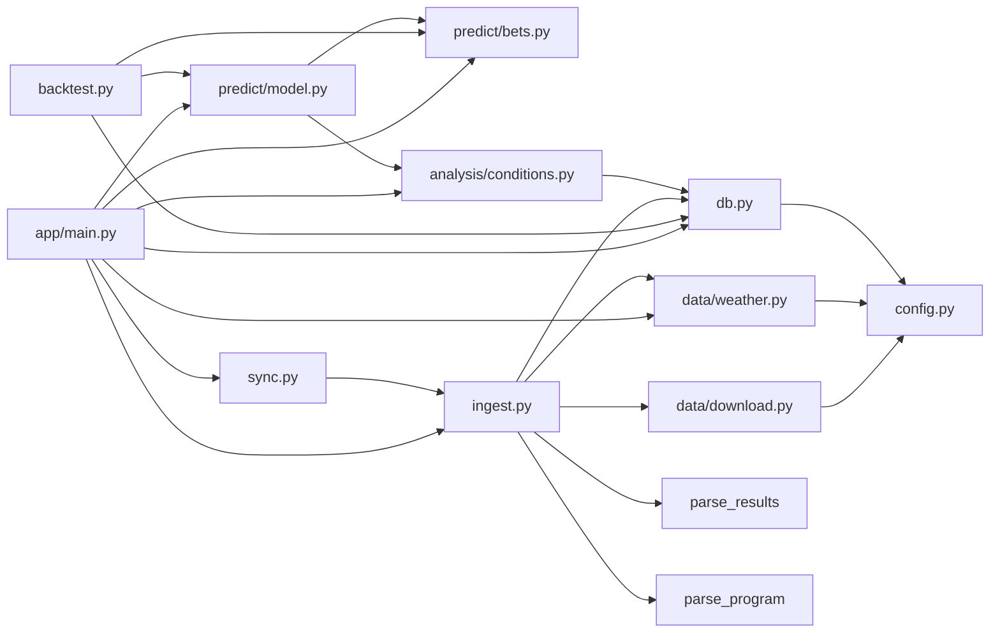
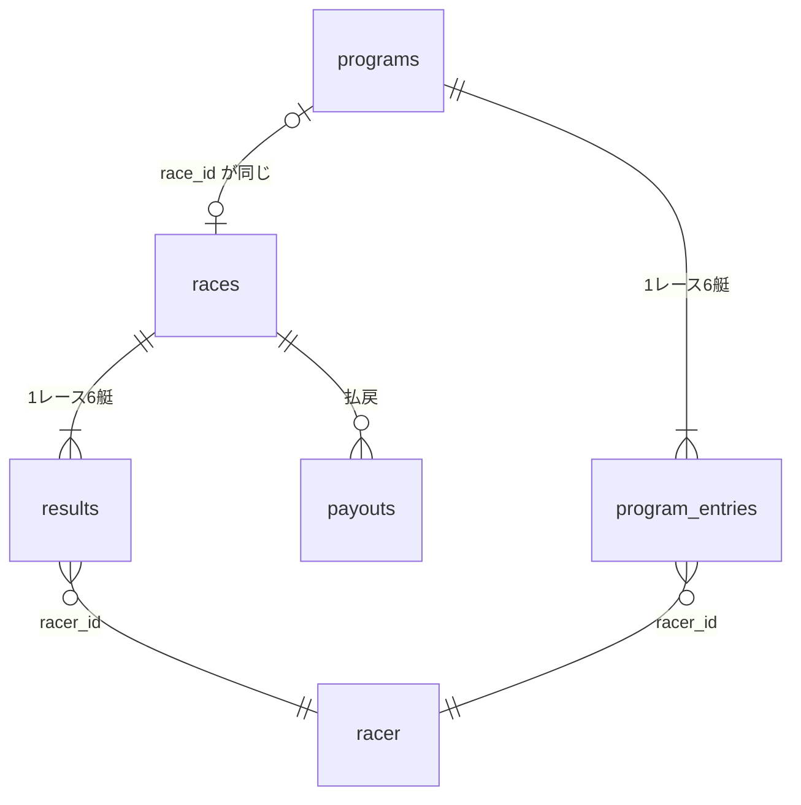
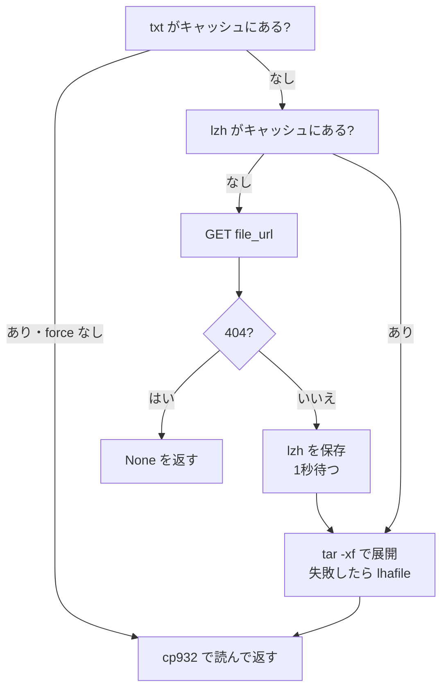
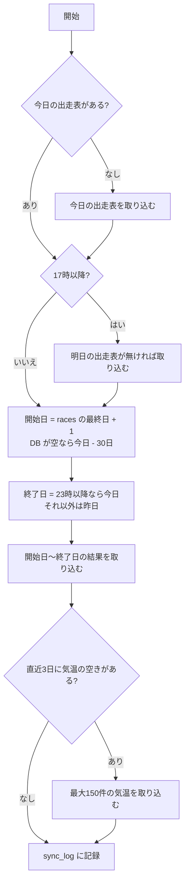

# 競艇予測システム 内部設計書

| 項目 | 内容 |
|---|---|
| システム名 | 競艇予測（BOATRACE PREDICTOR） |
| 文書版数 | 1.0 |
| 作成日 | 2026-11-13 |
| 関連文書 | [01_基本設計書](01_基本設計書.md) / [02_外部設計書](02_外部設計書.md) |

---

## 1. モジュール構成

### 1.1 ディレクトリ

```
Hikachius_App/                     (ブランチ app/boatrace)
├─ start_server.bat                LAN 公開で起動
├─ requirements.txt
├─ boatrace/                       ロジック（画面に依存しない）
│  ├─ __init__.py                  truststore の注入
│  ├─ config.py                    パス・URL・場コード・race_id
│  ├─ db.py                        スキーマ・接続・列の追加
│  ├─ ingest.py                    取り込み処理とコマンド
│  ├─ sync.py                      自動取り込み
│  ├─ backtest.py                  回収率の検証
│  ├─ data/
│  │  ├─ download.py               LZH の取得・展開・キャッシュ
│  │  ├─ parse_results.py          K ファイルのパーサー
│  │  ├─ parse_program.py          B ファイルのパーサー
│  │  └─ weather.py                公式サイトから気温など
│  ├─ analysis/
│  │  └─ conditions.py             条件の区分・選手の集計・枠の事前確率
│  └─ predict/
│     ├─ model.py                  強さスコアと着順確率
│     └─ bets.py                   券種別確率・的中確率・おすすめ
├─ app/                            Web 画面
│  ├─ main.py                      FastAPI のルーティング
│  ├─ templates/                   Jinja2（base / index / race / racers / racer / backtest / guide / settings）
│  └─ static/                      style.css / icon.svg / manifest.json
├─ docs/                           設計書
└─ data/                           実行時に作られる（Git 管理外）
   ├─ boatrace.db
   ├─ raw/{K,B}/{lzh,txt}/
   └─ backtest/*.json
```

### 1.2 依存関係



- `boatrace/` は `app/` に依存しない（コマンドからもバッチからも使える）。
- 外部への通信は `data/download.py` と `data/weather.py` だけが行う。

---

## 2. DB 設計

### 2.1 ER 図



`racer` はテーブルとしては持たない（`results` / `program_entries` の `racer_id` から集める）。

### 2.2 テーブル定義

#### races（レース）
| 列 | 型 | キー | 内容 |
|---|---|---|---|
| race_id | TEXT | PK | `YYYYMMDD-場-R` |
| date | TEXT | | YYYY-MM-DD |
| venue | TEXT | | 場コード 01〜24 |
| race_no | INTEGER | | 1〜12 |
| race_name | TEXT | | レース名（予選など） |
| distance | INTEGER | | 距離 m |
| weather | TEXT | | 晴 / 曇り / 雨 / 雪 / 霧 |
| wind_dir | TEXT | | 風向（北東・無風など） |
| wind_speed | INTEGER | | 風速 m |
| wave | INTEGER | | 波高 cm |
| temperature | REAL | | 気温 ℃（IF-03 で後から入れる。NULL あり） |
| water_temp | REAL | | 水温 ℃ |

#### results（結果）
| 列 | 型 | キー | 内容 |
|---|---|---|---|
| race_id | TEXT | PK1 | |
| lane | INTEGER | PK2 | 艇番 |
| racer_id | TEXT | IDX | 登録番号 |
| racer_name | TEXT | | 空白を除いた氏名 |
| motor_no / boat_no | INTEGER | | |
| exhibit_time | REAL | | 展示タイム |
| course | INTEGER | | 進入コース |
| start_timing | TEXT | | ST（`0.12`、`F0.01` など） |
| race_time | TEXT | | `1.49.5`（完走しなかったときは NULL） |
| finish | INTEGER | | 着順。数字以外は NULL |
| finish_raw | TEXT | | 元の表記（`01` / `F` / `K0` / `S1` など） |

インデックス: `idx_results_racer (racer_id)`

#### payouts（払戻）
| 列 | 型 | キー | 内容 |
|---|---|---|---|
| race_id | TEXT | PK1 | |
| bet_type | TEXT | PK2 | `win` / `place` / `exacta` / `quinella` / `wide` / `trifecta` / `trio` |
| combo | TEXT | PK3 | `1-2-3`。順番が関係ない券種は小さい順 |
| payout | INTEGER | | 100 円あたりの払戻金 |
| popularity | INTEGER | | 人気（単勝・複勝は NULL） |

#### programs（出走表のレース）
| 列 | 型 | キー | 内容 |
|---|---|---|---|
| race_id | TEXT | PK | |
| date / venue / race_no / race_name / distance | | | races と同じ |
| deadline | TEXT | | 締切予定 HH:MM（後から追加した列） |

#### program_entries（出走表の選手）
| 列 | 型 | キー | 内容 |
|---|---|---|---|
| race_id | TEXT | PK1 | |
| lane | INTEGER | PK2 | |
| racer_id / racer_name | TEXT | | |
| age / weight | INTEGER | | |
| branch | TEXT | | 支部 |
| grade | TEXT | | A1 / A2 / B1 / B2 |
| nat_win_rate / nat_2rate | REAL | | 全国勝率 / 2 連率 |
| local_win_rate / local_2rate | REAL | | 当地勝率 / 2 連率 |
| motor_no / boat_no | INTEGER | | |
| motor_2rate / boat_2rate | REAL | | |

#### sync_log（取り込み履歴）
| 列 | 型 | キー | 内容 |
|---|---|---|---|
| id | INTEGER | PK（自動採番） | |
| started / finished | TEXT | | ISO 形式の日時 |
| ok | INTEGER | | 1 = 成功 / 0 = 失敗 |
| message | TEXT | | 結果のメッセージ |

### 2.3 接続とスキーマの更新
- `db.connect()` は呼ばれるたびに新しい接続を作る（`timeout=30`、`check_same_thread=False`、`row_factory=sqlite3.Row`）。
- 毎回 `CREATE TABLE IF NOT EXISTS` を実行する。
- 後から追加した列は `MIGRATIONS = [(table, column, type)]` に書き、`PRAGMA table_info` で無ければ `ALTER TABLE ADD COLUMN` する。

### 2.4 書き込みのしかた

| 対象 | 方法 | 理由 |
|---|---|---|
| results / payouts / programs / program_entries | `INSERT OR REPLACE` | 取り込み直したら最新の内容で上書き |
| races | `INSERT … ON CONFLICT DO UPDATE`（気温・水温以外を更新） | 後から入れた気温を消さないため |

---

## 3. データ取り込み

### 3.1 download.fetch_text(kind, d, force=False)



- 保存先: `data/raw/{K|B}/lzh/{k|b}YYMMDD.lzh`、展開先: `data/raw/{K|B}/txt/`
- 展開後のファイル名は大文字になることがあるので、両方を探す。
- 出走表は内容が更新されることがあるので、`ingest_program_day` は `force=True` で取り直す。

### 3.2 parse_results.parse(text, d) → (races, results, payouts)

1. 1 行ずつ NFKC 正規化する（全角英数を半角に、半角カナを全角に）。
2. 状態として「今の場」「今のレース」「今の券種」を持つ。

| 正規表現 | 意味 | 処理 |
|---|---|---|
| `^(\d{2})KBGN` | 場の始まり | 場を設定し、レース・券種をリセット |
| `^(\d{2})KEND` | 場の終わり | 全部リセット |
| `^\s*(\d{1,2})R\s+(.*?)\s+H(\d{3,4})m\s+(\S+)\s+風\s+(\S+)\s+(\d+)m\s+波\s+(\d+)cm` | レース見出し | races に追加。場の始まりにある払戻のまとめは、レースが決まる前なので読み飛ばされる |
| `^\s*([0-9A-Z]{1,2})\s+([1-6])\s+(\d{4})\s+(.+?)\s+(\d{1,3})\s+(\d{1,3})(.*)$` | 選手行 | results に追加。残りは下の手順で分ける |
| `^\s*(単勝\|複勝\|2連単\|2連複\|拡連複\|3連単\|3連複)\s+(.*)$` | 払戻の行 | 券種を設定し、組番と金額を取り出す |
| `^\s{8,}([1-6](?:-[1-6]){0,2}\s+\d+.*)$` | 払戻の続きの行（拡連複など） | 今の券種で取り出す |
| `([1-6](?:-[1-6]){0,2})\s+(\d+)(?:\s+人気\s+(\d+))?` | 組番・金額・人気 | findall で全部 |

選手行の残り（`_parse_entry_tail`）: 空白で分け、順に「`d.dd` なら展示タイム」→「1 桁なら進入、その次が ST」→「`d.dd.d` ならレースタイム」。欠場などで項目が足りなくても止まらない。

### 3.3 parse_program.parse(text, d) → (programs, entries)

| 正規表現（NFKC 後） | 意味 |
|---|---|
| `^(\d{2})BBGN` / `^(\d{2})BEND` | 場の始まり / 終わり |
| `^\s*(\d{1,2})R\s+(.*?)\s+H(\d{3,4})m` | レース見出し |
| `締切予定\s*(\d{1,2}:\d{2})` | 締切時刻（`HH:MM` に 0 埋め） |
| `^([1-6])\s+(\d{4})(\D+?)(\d{2})(\D+?)(\d{2})(A1\|A2\|B1\|B2)\s*(\d+\.\d{2})\s*(\d+\.\d{2})\s*(\d+\.\d{2})\s*(\d+\.\d{2})\s*(\d+)\s*(\d+\.\d{2})\s*(\d+)\s*(\d+\.\d{2})` | 選手行 |

選手行の区切りの考え方: 列の幅が固定なので、3 桁の番号は前の値とくっつく。勝率・2 連率は必ず小数 2 桁なので、`\d+\.\d{2}` で区切れば正しく分けられる（福岡のボート番号 103〜171 で確認済み）。

### 3.4 weather.fetch(page, d, venue, race_no) → dict
1. `requests.Session` を使い回して GET する（毎回つなぐと 1 件約 10 秒、使い回すと約 0.2 秒）。
2. 1 秒待つ。
3. HTML のタグを空白にし、文字参照を戻し、空白をまとめる。
4. 次を探す: `気温\s*([\d.]+)\s*℃`、`水温\s*([\d.]+)\s*℃`、`風速\s*(\d+)\s*m`、`波高\s*(\d+)\s*cm`。
5. 天候は「気温」の前 40 字〜後 80 字の中にある 晴 / 曇り / 雨 / 雪 / 霧。
6. 見つからない項目は dict に入れない。

### 3.5 ingest の関数

| 関数 | 処理 | 戻り値 |
|---|---|---|
| `ingest_results_day(conn, d)` | K を取得 → 解析 → races を upsert、results / payouts を置き換え → commit | レース数（ファイルが無ければ 0） |
| `ingest_program_day(conn, d)` | B を取り直し → 解析 → programs / program_entries を置き換え → commit | レース数 |
| `ingest_temps(conn, start, end, venue, limit)` | 気温が NULL のレースを新しい順に最大 `limit` 件 → IF-03 → 取れたら UPDATE して 1 件ごとに commit。失敗は表示して次へ | 取れた件数 |

---

## 4. 自動取り込み（sync.py）

### 4.1 定数

| 名前 | 値 | 意味 |
|---|---|---|
| `INTERVAL_SEC` | 3600 | 実行の間隔 |
| `MAX_BACKFILL_DAYS` | 30 | DB が空のときに遡る日数 |
| `TEMPS_PER_RUN` | 150 | 1 回に取る気温の最大件数（約 3〜7 分） |

### 4.2 1 回の処理（`_sync(now)`）



- 何回動かしても同じ結果になる（足りない分だけを取りに行く）。
- 例外が出たら `ok=0` とメッセージを記録し、次の回にやり直す。

### 4.3 排他とスレッド
- モジュール変数 `_lock`（`threading.Lock`）を、待たずに取る。取れなければ「ほかの更新が動いているのでスキップ」を返す（定期実行と「今すぐ更新」が重ならない）。
- `AutoSync` は daemon スレッドで「`sync_once()` → `Event.wait(INTERVAL_SEC)`」を繰り返す。
- FastAPI の lifespan で起動・停止する。環境変数 `BOATRACE_AUTO_SYNC=0` なら起動しない。
- ログは `print(..., flush=True)`（uvicorn のログと一緒にすぐ出るように）。

---

## 5. 予想ロジック

### 5.1 条件の区分（analysis/conditions.py）

| 条件 | 列 | 区分 |
|---|---|---|
| 天候 `weather` | weather | 晴 / 曇 / 雨 / 雪 / 霧（文字を含むかで判定） |
| 風 `wind` | wind_speed | 弱風(0-2m) / 中風(3-4m) / 強風(5m以上) |
| 波 `wave` | wave | 静水(0-3cm) / やや波(4-7cm) / 荒水(8cm以上) |
| 気温 `temp` | temperature | 寒い(10℃未満) / 涼しい(10-20℃) / 暖かい(20-28℃) / 暑い(28℃以上) |

### 5.2 選手の集計 `racer_profile(conn, racer_id, before_date=None)`
- 対象: その選手の results（欠場 `K*` は除く）。`before_date` を渡すと、その日より前のレースだけを使う。
- 集計: 通算 / 枠ごと / 場ごと / 条件の区分ごとに `Tally(starts, wins, top2, top3)`。
- フライング・失格などの着順なしは「走ったが入着なし」として数える。

### 5.3 枠の事前確率 `lane_prior(conn, venue, lane)`
その場・その枠の 3 着以内の割合。300 走未満なら全国の値、それも足りなければ固定値（1 枠 0.75、2 枠 0.55、3 枠 0.50、4 枠 0.45、5 枠 0.35、6 枠 0.25）。結果はプロセス内でキャッシュする。

### 5.4 強さスコア（predict/model.py `score_entries`）

艇ごとに次の順でスコア *s* を作る。logit(p) = ln(p / (1 − p))。p は 0.01〜0.99 に丸める。

1. **枠と選手の実績**
   base = (その枠での 3 着以内の回数 + 20 × 枠の事前確率) ÷ (その枠での走数 + 20)
   *s* = logit(base)
2. **条件ごとの補正**（入力された条件の数だけ足す）
   overall = 選手の通算の 3 着以内の割合（実績が無ければ枠の事前確率）
   shrunk = (その区分での 3 着以内の回数 + 15 × overall) ÷ (その区分での走数 + 15)
   delta = 0.6 × (logit(shrunk) − logit(overall))
   *s* += delta
3. **勝率** *s* += 0.25 × (全国勝率 − 5.5)
4. **モーター** *s* += 1.5 × (モーター 2 連率 − 33) ÷ 100

| 定数 | 値 | 意味 |
|---|---|---|
| `SHRINK_LANE` | 20 | 枠の実績を平均に寄せる強さ（20 走で半々） |
| `SHRINK_COND` | 15 | 条件の実績を平均に寄せる強さ |
| `COND_WEIGHT` | 0.6 | 条件補正の効き具合 |
| `WIN_RATE_WEIGHT` | 0.25 | 勝率の効き具合 |
| `MOTOR_WEIGHT` | 1.5 | モーターの効き具合 |
| `BETA` | 1.1 | スコアの差を確率の差にする強さ |

「平均に寄せる」は、走数が少ない選手のたまたまの成績に振り回されないための処理（ベイズ的な縮小推定）。

### 5.5 着順の確率（Plackett-Luce モデル）
強さ *w*ᵢ = exp(β × *s*ᵢ)、*W* = Σ*w* として、1・2・3 着が a・b・c になる確率は

P(a, b, c) = *w*ₐ / *W* × *w*ᵦ / (*W* − *w*ₐ) × *w*꜀ / (*W* − *w*ₐ − *w*ᵦ)

6 艇で 120 通りを全部計算する。各艇の 1 着・2 着以内・3 着以内の確率は、この 120 通りの合計。

### 5.6 券種ごとの確率（predict/bets.py `combo_probs`）

| 券種 | 120 通りの各並び (a, b, c) を足し込む先 |
|---|---|
| 単勝 | a |
| 複勝 | a と b（6 艇立てなので 2 着まで） |
| 2 連単 | a-b |
| 2 連複 | a・b を小さい順 |
| 拡連複 | {a, b, c} から 2 艇の組 3 通り |
| 3 連単 | a-b-c |
| 3 連複 | a・b・c を小さい順 |

### 5.7 当たる確率 `hit_probability(order_probs, bet_type, combos)`
「買い目のどれか 1 つでも当たる」確率 = 120 通りのうち、どれかの買い目が当たる並びの確率の合計。拡連複・複勝は 1 レースで複数当たりうるので、確率を単純に足すと 100% を超える。そのためこの方法で計算する。

### 5.8 おすすめ `recommend(order_probs, win_probs)`
外部設計書 4.2.2 (1) の表のとおり。3 連単のときは、確率の高い順に 20 点を出してから、本命が 1 着のものだけを 6 点残す。

### 5.9 画面向けの計算（app/main.py）
- レースの堅さ `_race_type(p1, p2)`: 外部設計書 4.2.1 の表のとおり。
- 1 点あたりの金額: `max(100, budget // n // 100 * 100)`
- 得意・苦手の表示: `delta > 0.05` で得意、`< −0.05` で苦手。

---

## 6. 回収率の検証（backtest.py）

### 6.1 対象
`programs` と `races` の両方があり、出走表に 6 艇そろい、1 着がいるレース。

### 6.2 手順（1 レースごと）
1. 条件にはレース後に記録された天候・風速・波高・気温を使う（直前情報を入れた想定）。
2. `score_entries(…, before_date=レースの日)` で、その日より前のデータだけを使って予想する（未来の情報を混ぜない）。
3. 次の買い方で、1 点 100 円で買ったとして payouts と突き合わせる。

| 名前 | 券種 | 点数 |
|---|---|---|
| ★おすすめ | `recommend()` が選んだもの | 3〜6 |
| 単勝 本命1点 / 複勝 本命1点 | 単勝 / 複勝 | 1 |
| 2連単 / 2連複 / 拡連複 上位2点 | 各券種 | 2 |
| 3連単 上位6点 | 3 連単 | 6 |
| 3連複 上位4点 | 3 連複 | 4 |
| 【比較】1号艇の単勝 | 単勝 `1` 固定 | 1 |
| 【比較】3連単 1-2-3 | 3 連単 `1-2-3` 固定 | 1 |

4. ほかに、おすすめの券種ごと、本命の単勝の自信度ごと（〜40% / 40〜55% / 55〜70% / 70%〜）、確率の当たり具合（予想 1 着率を 10% 刻み）を集計する。

### 6.3 指標
| 指標 | 計算 |
|---|---|
| 的中率 | 1 点でも当たったレース ÷ 買ったレース |
| 回収率 | 払戻の合計 ÷ 投資の合計 |
| 最高払戻 | 1 レースで戻った金額の最大 |

返還（フライング艇の返還金など）は考えていない（外れとして数える）。

### 6.4 係数の調整のしかた
`BETA` は、2026/11/05〜11/11 の 984 レースで、実際の 1 着の対数尤度が最大になる値を探して決めた（0.3〜1.4 で探して、1.0〜1.2 が最良）。検証は、それとかぶらない 2026/10/20〜11/04 で行う。

---

## 7. Web アプリ（app/main.py）

| 項目 | 内容 |
|---|---|
| 起動 | lifespan で `AutoSync` を開始・停止 |
| 描画 | `_render(request, template, tab, /, **ctx)`。全画面に `tab`（選択中のタブ）と `sync`（最新の取り込み履歴）を渡す |
| テンプレートの共通値 | `VENUES`、`BET_TYPES`、`BET_GUIDE`、`GRADE_LABEL`、`TELEBOAT_URL` |
| フィルター | `pct`（小数 1 桁の %）、`pct0`（整数の %）、`yen`（3 桁区切り + 円） |
| `weather` パラメータ | `weather` モジュールと名前が同じなので、`request.query_params` から直接読む |
| LAN アドレス | UDP ソケットを `192.0.2.1:80`（例示用のアドレス）に connect し、`getsockname()` で自分のアドレスを得る（実際には送信しない） |
| QR コード | `segno.make(url).svg_inline(...)` をテンプレートに埋め込む |
| 検証結果 | `data/backtest/*.json` を読み、レース数の多い順に並べる。SC-02 の「過去の成績」は先頭の結果を使う |
| サブタブ | 表示の切り替えはブラウザ側の JS。`location.hash` で選択を覚える |
| コピー | `navigator.clipboard.writeText`。使えないときは隠した textarea を選んで `execCommand('copy')` |

---

## 8. エラー処理とログ

| 場所 | 起きること | 対応 |
|---|---|---|
| ファイルの取得 | 404 | 開催なしとして 0 件 |
| ファイルの取得 | 通信エラー・500 番台 | 例外 → 自動取り込みなら `ok=0` で記録して次の回にやり直す |
| LZH の展開 | tar で失敗 | lhafile を試す。無ければ「bsdtar か lhafile が必要」の例外 |
| 気温の取得 | 1 件の失敗 | 表示して次の件へ |
| 証明書 | 公式サーバーが中間証明書を送らない | `truststore.inject_into_ssl()` で OS の証明書ストアを使う（検証は切らない） |
| DB | ロック | `timeout=30` で待つ |
| 画面 | 出走表が無いレース | 404 |

ログは標準出力（uvicorn のコンソール）に出す。自動取り込みの結果は `sync_log` にも残す。

---

## 9. 性能

| 処理 | 内容 | 目安 |
|---|---|---|
| レース予想画面 | 6 艇 × (`racer_profile` の SELECT 1 回 + `lane_prior`) + 120 通りの計算 | 1 秒未満 |
| 結果の取り込み | 1 日 1 ファイル（約 37KB → 約 180KB のテキスト） | 数秒 |
| 気温の取り込み | 1 レース 1 リクエスト + 1 秒待ち | 約 1.2 秒 / 件 |
| 回収率の検証 | 1 レースごとに予想を 1 回 | 2,440 レースで数分 |

---

## 10. 検証の実績（2026-11-13）

| 対象 | 内容 | 結果 |
|---|---|---|
| K ファイル | 2026/11/12 の 156 レースを元のテキストと突き合わせ | 全レース 6 艇。着順・展示・ST・払戻が一致。単勝の特払い 1 件は対象外で正しい |
| K ファイル | 2026/07/01〜11/12 を取り込み | 全レース 6 艇そろう |
| B ファイル | 2026/11/13 の 156 レース | 修正後、全レース 6 艇（3 桁のボート番号を含む） |
| 気温 | 結果ページ・直前情報ページ | 取得できる。自動取り込みで 150 件を取り込み、成功を記録 |
| 画面 | 全 9 ページ | HTTP 200。スマホ幅（375px）で横にはみ出さない |
| 確率の当たり具合 | 2026/10/20〜11/04 | 予想 30〜40% → 実際 34.9%、予想 60〜70% → 実際 65.7%。予想 70% 以上は高めに出る |
| 回収率 | 2026/10/20〜11/04、2,440 レース | 最高は複勝 本命 1 点 95.5%。おすすめは 79.8% |

---

## 11. 既知の制約と改善候補

| No | 内容 | 改善案 |
|---|---|---|
| K-01 | `lane_prior` のキャッシュは、サーバーを再起動するまで更新されない | 日付ごとにキャッシュを捨てる |
| K-02 | `db.connect()` の接続を明示的に閉じていない | リクエストごとに依存性注入で開閉する |
| K-03 | おすすめが 3 連単を選ぶことが多いが、3 連単の回収率は低い | 検証結果を見て判定の境目を変える。またはオッズの期待値で選ぶ |
| K-04 | 予想 1 着率 70% 以上で確率が高く出すぎる | 確率の補正（Platt scaling など）や機械学習を入れる |
| K-05 | 返還を考えていないので、回収率が少し低めに出る | payouts に返還を入れる |
| K-06 | 風は強さだけで、向き（追い風・向かい風）を見ていない | 場ごとのスタンドの向きと合わせて区分する |
| K-07 | 自動テストが無い | パーサーと確率計算に、保存したサンプルファイルを使った単体テストを作る |
